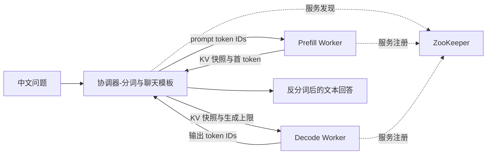

# LLM-RPC

LLM-RPC 是一个 C++14 CPU 推理与 RPC 学习项目，支持 **Qwen2.5-0.5B-Instruct 中文单轮问答**。Prefill 和 Decode 由两个独立进程执行，协调器通过 TCP RPC 传递请求内 KV 快照。Decode 恢复缓存后继续生成，无需重算 prompt。

## 系统架构



- **原生推理**。项目内实现 FP32 CPU Transformer 前向、GQA、RoPE、RMSNorm 和 greedy 生成。支持 `stories260K`，以及由 `safetensors-cpp` 直接读取的 Qwen 官方 BF16 权重。Qwen 权重加载后以 FP32 计算。
- **请求内 KV Cache**。按层存储每条序列的 K/V，支持版本化快照、跨进程文件交接和 RPC 交接。恢复时校验模型指纹、张量形状和位置。
- **RPC 传输**。以 Muduo 和 Protobuf 实现 TCP RPC，支持 ZooKeeper 注册与发现、连接复用、完整收发、帧长度校验和建连及收发截止时间。
- **文本问答**。C++ 客户端负责 Qwen BPE、单轮聊天模板和反分词。运行无需 Python。当前使用 256 token 的模型上下文，提示词模板和问题也占用上下文。

## 快速运行 Qwen 问答

环境为 Linux 或 WSL Ubuntu。构建需 C++14 编译器、CMake、Protobuf 开发库及 `protoc`、Muduo、ZooKeeper 多线程客户端库、glog 和 ICU 开发库（Ubuntu 包名 `libicu-dev`）。运行分离推理还需可连接的 ZooKeeper 服务。

在 `~/ModelWeights/Qwen2.5-0.5B-Instruct/` 放置 `model.safetensors`、`tokenizer.json` 和 `tokenizer_config.json`，建议三个文件使用同一官方版本。 [Qwen 官方模型文件](https://huggingface.co/Qwen/Qwen2.5-0.5B-Instruct/tree/7ae557604adf67be50417f59c2c2f167def9a775)

在项目根目录构建并创建 worker 配置：

```bash
cmake -S . -B build -DCMAKE_BUILD_TYPE=Release
cmake --build build -j 4
sudo systemctl start zookeeper

sed 's/^rpcserverport=.*/rpcserverport=8101/' bin/test.conf > bin/prefill.conf
sed 's/^rpcserverport=.*/rpcserverport=8102/' bin/test.conf > bin/decode.conf
```

在两个终端分别执行以下命令。两个终端都从项目根目录启动：

```bash
# 终端 1
./bin/llm_rpc_inference_worker prefill \
  "$HOME/ModelWeights/Qwen2.5-0.5B-Instruct/model.safetensors" -i bin/prefill.conf

# 终端 2
./bin/llm_rpc_inference_worker decode \
  "$HOME/ModelWeights/Qwen2.5-0.5B-Instruct/model.safetensors" -i bin/decode.conf
```

两个 worker 都输出 `RpcProvider start service` 后，在第三个终端发起问答：

```bash
./bin/llm_rpc_inference_client -i bin/test.conf --chat \
  "$HOME/ModelWeights/Qwen2.5-0.5B-Instruct" \
  '1加1等于几？只回答数字。' 4 60000 42
```

实测输出为 `2`。最后三个参数依次为最大输出 token 数、RPC 超时毫秒数和请求 ID。使用 `Release` 构建可以缩短 CPU 前向耗时。

## 项目结构

| 位置 | 内容 |
| --- | --- |
| `src/`、`src/include/` | RPC 客户端与服务端、连接池、服务发现 |
| `src/inference/` | 模型加载与前向、KV 快照、分词、推理协议和 worker |
| `example/` | 原有 Login RPC 客户端与服务端示例 |
| `third_party/` | 权重及 JSON 读取组件和对应许可 |
| `docs/` | 设计文档及请求时序图 |

## 实现进度与计划

| 阶段 | 状态 | 功能与验收 |
| --- | --- | --- |
| M0 单进程基线 | 已完成 | 原生权重加载和前向，以固定输入对照 logits 与 greedy token |
| M1 请求内 KV 与文件交接 | 已完成 | Prefill 导出快照，独立 Decode 进程恢复并续写，输出与单进程一致 |
| M2 RPC 分离 | 已完成 | 协调器经 ZooKeeper 路由并中转快照，已验证短读短写、超时恢复及 Decode 零 prompt 前向 |
| Qwen BF16 与文本问答 | 已完成 | 直接读取官方未量化权重，验证单进程、文件交接和 RPC 输出一致，实测中文单轮问答 |
| M3 跨请求复用与基准 | 待实现 | Prefill 侧按模型指纹、快照配置和完整 prompt token 序列查找不可变快照，命中时跳过 Prefill。按字节预算做 LRU 淘汰，传输期间保持快照引用有效 |
| Qwen 独立参考校验 | 待完成 | 对照官方参考的 logits、greedy token、分词和模板输入 ID，并补充模型不兼容回归 |
| Qwen Q4_K_M GGUF | 待实现 | 读取 GGUF 元数据与量化张量，验证量化模型的输出，记录耗时及内存占用 |
| 运行时扩展 | 待实现 | CUDA、连续批处理和流式输出 |

M3 将比较 **单进程 KV、双进程冷缓存、双进程热缓存**，记录 Prefill、导出、传输、导入耗时、快照大小、端到端延迟与 Decode tokens/s。验收覆盖重复 prompt 命中、不同 token 序列未命中及超预算淘汰。详细的模型兼容性约定、快照布局和后续计划见 [Prefill/Decode 与 KV Cache 设计](docs/prefill-decode-kv-cache.md)。
