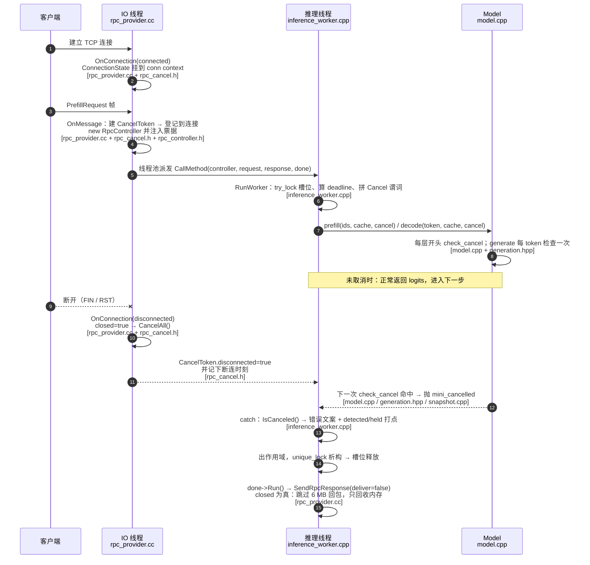

# 请求取消传播：客户端断连后立即释放推理槽位

相关代码：[`src/include/rpc_cancel.h`](../src/include/rpc_cancel.h)、[`src/rpc_provider.cc`](../src/rpc_provider.cc)、[`src/inference/inference_worker.cpp`](../src/inference/inference_worker.cpp)。验证脚本：[`scripts/cancel_demo.sh`](../scripts/cancel_demo.sh)。

## 问题

一个 worker 进程同一时刻只跑一个请求（`RunWorker` 用 `try_lock` 抢占唯一槽位）。原先客户端断开后服务端毫不知情，推理会一直算到 deadline 才结束，这段时间里唯一槽位被一个**没人要的结果**占着，新请求只能拿到 `inference worker busy`。

目标：客户端断连后，推理在下一次检查点立刻中止，槽位毫秒级释放，并且不再为已消失的客户端序列化 6 MB 的 KV 快照。

## 三个决定实现的约束

1. **连接是被复用的**。`RpcConnectionPool` 会把 fd 放回池子重复借出，一条连接上可能同时有多个在飞请求（`OnMessage` 的 `while` 循环一次能处理多帧）。因此取消的粒度必须是"该连接上的全部在飞请求"，不是"一个连接一个 bool"。
2. **这版 Muduo 的 `TcpConnection::state_` 不是原子变量**（头文件里自己标注了 `// FIXME: use atomic variable`），推理线程不能读 `conn->connected()`。必须用我们自己的 `std::atomic<bool>`。`setContext/getContext` 也只能在 IO 线程使用。
3. **FIN 不是万能的**。正常关闭、进程被杀、进程崩溃都会发 FIN/RST；网络分区、拔网线、机器掉电不会。所以断连是"快路径"，deadline 是"兜底"，二者必须同时存在于取消条件里。

## 总体结构



图中 `[文件]` 标注该步骤的实现位置，`+` 表示跨文件协作；泳道标题下的文件是该线程的主要实现文件。

线程模型上没有任何跨线程锁，只有两个 atomic 做交接：`ConnectionState::closed` 与 `CancelToken::disconnected`。其余状态都是线程内独占——`inflight` 表只在 IO 线程动，`slot_` 只在推理线程动。

## 数据结构

### CancelToken：一次请求的取消票据

```cpp
struct CancelToken
{
    static long long Now() noexcept
    {
        return std::chrono::steady_clock::now().time_since_epoch().count();
    }

    void CancelByDisconnect() noexcept
    {
        disconnected_at.store(Now(), std::memory_order_relaxed); // 先写时刻
        disconnected.store(true, std::memory_order_release);     // 再发布标志
    }

    bool Cancelled() const noexcept
    {
        return disconnected.load(std::memory_order_acquire);     // 读到 true 时时刻必有效
    }

    std::atomic<bool> disconnected{false};
    std::atomic<long long> disconnected_at{0};
};
```

`release` / `acquire` 成对使用，保证"读到已取消"时 `disconnected_at` 一定不是 0，取消延迟的统计不会出现无效样本。

### ConnectionState：一条连接上的在飞请求名单

```cpp
struct ConnectionState
{
    void Register(const std::shared_ptr<CancelToken> &token)
    {
        std::lock_guard<std::mutex> lock(mutex);
        // 顺手清理已结束的请求，保证表不会无限增长
        inflight.erase(std::remove_if(inflight.begin(), inflight.end(),
                                      [](const std::weak_ptr<CancelToken> &weak)
                                      { return weak.expired(); }),
                       inflight.end());
        if (closed.load(std::memory_order_relaxed)) // 极端时序：登记时已断连
        {
            token->CancelByDisconnect();
            return;
        }
        inflight.push_back(token);
    }

    void CancelAll()
    {
        std::lock_guard<std::mutex> lock(mutex);
        for (auto &weak : inflight)
            if (auto token = weak.lock())
                token->CancelByDisconnect();
        inflight.clear();
    }

    std::atomic<bool> closed{false};
    std::mutex mutex;
    std::vector<std::weak_ptr<CancelToken>> inflight;
};
```

用 `weak_ptr` 登记而不是 `shared_ptr` + 显式注销：请求结束时控制器析构、票据引用归零，`expired()` 自动为真，下一次 `Register` 顺手压缩掉。**"已完成"这个状态由所有权自动表达，不需要代码维护**，也就不会出现"漏注销导致泄漏"或"误杀已完成请求"。

### RpcController：票据的搬运工

```cpp
// rpc_controller.h
void SetCancelToken(const std::shared_ptr<CancelToken> &token) { m_cancel = token; }
const std::shared_ptr<CancelToken> &GetCancelToken() const { return m_cancel; }

// rpc_controller.cc
bool RpcController::IsCanceled() const
{
    return m_cancel && m_cancel->Cancelled(); // 客户端侧 m_cancel 为空 → 恒 false
}
```

protobuf 生成的服务方法签名是固定的 `(controller, request, response, done)`，`controller` 是唯一扩展位；而 `google::protobuf::RpcController::IsCanceled()` 本来的语义就是"客户端是否取消了本次调用"。所以这里不是发明接口，而是把框架原本的意思实现掉。客户端侧不注入票据，行为与改动前完全一致。

## 代码走读

### 1. 连接建立：挂状态

```cpp
void RpcProvider::OnConnection(const muduo::net::TcpConnectionPtr &conn)
{
    if (conn->connected())
    {
        // 只能在这里（IO 线程）调用 setContext，不能跨线程访问
        conn->setContext(std::make_shared<ConnectionState>());
        return;
    }
    // ... 断连分支见第 4 步
}
```

用 `setContext` 而不是维护 `unordered_map<连接, 状态>`：不用手工 erase、不会泄漏、不会因为连接对象地址复用而串状态。

### 2. 请求到达：发票据、登记、注入

在`OnMessage`中收到

```cpp
void RpcProvider::OnMessage(){
    ...
	std::shared_ptr<ConnectionState> state;
    if (const auto *slot = boost::any_cast<std::shared_ptr<ConnectionState>>(&conn->getContext()))
        state = *slot;

    auto token = std::make_shared<CancelToken>();
    if (state)
        state->Register(token);

    // 服务端控制器：业务层通过 IsCanceled() 得知客户端是否已断开
    auto *controller = new RpcController;
    controller->SetCancelToken(token);
    ...
}
```

`Register` 内部对"登记时连接已断"做了防御，直接把票据置位——不依赖"断连后不会有消息回调"这个假设。

### 3. 执行：票据变成 Cancel 谓词

```cpp
const auto deadline = std::chrono::steady_clock::now() +
                      std::chrono::milliseconds(timeout);

const Cancel cancelled = [controller, deadline]
{
    return (controller && controller->IsCanceled()) ||
           std::chrono::steady_clock::now() >= deadline;
};

work(cancelled);

// 算完了但期间已取消：结果作废，槽位照常释放
if (cancelled())
    throw std::runtime_error("inference cancelled");
```

`Cancel` 的类型仍是 `std::function<bool()>`，所以 `Model::prefill`、`Model::decode`、`generate`、`KVSnapshot::encode` 的签名完全不用改，只是多了一个可能提前返回 true 的谓词。

### 4. 断连：置位所有票据

`OnConnection`中触发断连

```cpp
// 注意不能读 conn->connected()：这版 muduo 的 state_ 不是原子变量
const auto *slot =
    boost::any_cast<std::shared_ptr<ConnectionState>>(&conn->getContext());
if (slot && *slot)
{
    (*slot)->closed.store(true, std::memory_order_relaxed);
    (*slot)->CancelAll();
}
conn->shutdown();
```

非法帧路径里的 `forceClose()` 同样会触发 disconnected 回调，因此也能自动取消，不需要额外代码。

### 5. 收尾：释放槽位、按需跳过回包

```cpp
catch (const std::exception &error)
{
    const bool disconnected = controller && controller->IsCanceled();
    reply->Clear();
    reply->set_error(disconnected ? "request cancelled: client disconnected"
                                  : error.what());
    // 记录取消延迟与槽位占用时长

} // unique_lock 析构 → 槽位释放

done->Run(); // closed 为真时 SendRpcResponse(deliver=false)，只回收不发送
```

槽位释放没有任何显式代码——`unique_lock` 的作用域就是释放点。取消要做的只是让 `work()` 尽快抛异常。

错误文案必须在这里覆盖：`generate` 抛的是 `"inference deadline exceeded"`，`check_cancel` 抛的是 `"mini_cancelled"`，对客户端都没有意义；`IsCanceled()` 是区分"断连"与"超时"的唯一信息源。

## 取消检查点与粒度

| 位置 | 频率 | 说明 |
| --- | --- | --- |
| `Model::forward_token` 每层开头 | 每 token × 24 层 | 取消响应的主要上界 = 一次 layer forward |
| `Model::forward_token` 提交 token 前 | 每 token × 1 | 避免"算完才提交"的窗口 |
| `generate` 每生成一个 token 前 | 每 token × 1 | decode 阶段的检查点 |
| `KVSnapshot::write` 每层前 | 每 token × 24 层 | 6 MB 序列化是纯 CPU 工作，断连后不必写满 |

结论：**响应上界是一次 layer forward**，实测 0～28 ms。

## 线程安全

| 数据 | 写者 | 读者 | 同步手段 |
| --- | --- | --- | --- |
| `ConnectionState::closed` | IO 线程 | 推理线程 | `atomic<bool>`，relaxed |
| `CancelToken::disconnected` | IO 线程 | 推理线程 | release / acquire |
| `CancelToken::disconnected_at` | IO 线程 | 推理线程 | relaxed（在 acquire 之后读） |
| `inflight` | IO 线程 | IO 线程 | `mutex`（防御性，为将来换线程保留） |
| `controller::m_cancel` | IO 线程（派发前） | 推理线程 | 无锁；线程池入队/出队提供 happens-before |
| `slot_` | 推理线程 | 推理线程 | `mutex` + `try_to_lock` |
| `conn->context` | IO 线程 | IO 线程 | 无锁；Muduo 保证同连接同 loop |

`m_cancel` 不需要锁的理由：它在 `m_thread_pool.run(...)` 之前写完，线程池内部的互斥构成 happens-before，"派发前写、派发后读"天然安全。

## 关键决策与反例

| 决策 | 如果反过来做 |
| --- | --- |
| 登记表挂在连接上，用 `weak_ptr` | 用 `shared_ptr` 必须显式注销：漏注销则泄漏，提前注销则漏掉取消 |
| 自带 `atomic closed`，不读 `conn->connected()` | 跨线程读非原子 `state_` 是数据竞争（Muduo 自己标了 FIXME） |
| 票据经 `RpcController` 传递 | 改 protobuf 方法签名要动 proto 和全部生成代码；用线程局部变量则引入隐式耦合 |
| `Cancel` 保持 `std::function<bool()>` | 改成枚举或结构体，要连带修改 model / generation / snapshot 四处签名 |
| 断连 + deadline 双条件 | 只靠断连：网络分区永远取消不了；只靠 deadline：要等满 60 秒 |
| 回包前判 `closed` | 无条件回包：为已经消失的客户端序列化 6 MB，纯浪费 CPU |

## 验证

```bash
# 前置：ZooKeeper 已启动；bin/prefill.conf 与 bin/decode.conf 已配好不同端口
./scripts/cancel_demo.sh
./scripts/cancel_demo.sh /path/to/model.safetensors   # 指定权重
```

脚本自动起停 worker，依次验证三个场景。实测环境为 WSL Ubuntu、Qwen2.5-0.5B-Instruct FP32 CPU、单推理槽位：

```
[2/5] 场景 A：槽位被占用（不取消），新请求应立即被拒绝
      结果: busy（符合预期），往返 2387 ms（含客户端启动）

[3/5] 场景 B：prefill 中途断连，槽位应迅速释放
      结果: 成功 -> 2，耗时 10338 ms

[4/5] 场景 C：decode 中途断连（长生成被中断）
      结果: 成功 -> 2，耗时 10348 ms

[5/5] 服务端取消日志（detected = 断连到被推理线程观察到的延迟）
  prefill:
    [worker] cancelled: detected 0 ms after disconnect, slot held 8030 ms
    [worker] cancelled: detected 28 ms after disconnect, slot held 5684 ms
  decode :
    [worker] cancelled: detected 2 ms after disconnect, slot held 10887 ms
```

上表为单次运行记录。`耗时` 会随机器负载与权重页缓存状态浮动（冷缓存时同一场景可能接近 20 秒），`detected` 才是本次改动的核心指标；多次运行的下界为 0 ms、上界约 30 ms。

三个结论：

1. 场景 A 说明 busy 语义没有被破坏：槽位真被占用时依然立刻拒绝。
2. 场景 B / C 说明断连后槽位确实被释放：新请求拿到正确答案，而不是 `inference worker busy`。改动前，第二个请求要等到 60 秒 deadline 才有机会。
3. 取消发现延迟 0～28 ms，上界与"一次 layer forward"的预期一致。

## 边界与未做的事

- 取消来源只有"连接关闭"，协议里没有取消帧；`StartCancel()` 仍是空实现。
- 当前客户端是一请求一连接（连接池借还），close 语义足够。**若将来支持长连接多路复用，必须引入显式 Cancel 帧**，否则关连接会误杀同连接上的其他请求。
- 没有 FIN 的场景（网络分区、掉电）只能靠 deadline。
- 取消粒度是一次 layer forward；若某层将来变成超长算子，响应延迟会随之变长。
- 请求在线程池里排队但服务端关闭时，`controller/response/request` 会泄漏——这是改动前就存在的资源回收模式，不属于本次改动。
- 没有实现排队与准入控制：`try_to_lock` 仍是非阻塞，槽位释放前的几十毫秒窗口里到达的请求会直接拿到 `busy`。

## 60 秒速记

客户端断连时服务端毫不知情，推理会一直跑到 deadline 占着唯一槽位。四件事解决：

1. 每条连接挂一个 `ConnectionState`，用 `weak_ptr` 登记该连接上所有在飞请求的取消票据——连接池会复用 fd，取消粒度必须是连接级，而 `weak_ptr` 让"请求结束"自动失效，不会误杀后续请求。
2. `OnConnection` 收到断连时置位 `closed` 并 `CancelAll`；刻意不读 `conn->connected()`，因为这版 Muduo 的 `state_` 不是原子变量。
3. 票据通过 `RpcController` 传给业务层——protobuf 服务方法签名固定，而 `IsCanceled()` 本来就是"客户端是否取消"的标准接口，之前是空壳。
4. 推理侧把票据和 deadline 合成同一个 `Cancel` 谓词，检查点放在每层前向，所以取消发现延迟就是一次 layer forward，实测 0～28 ms；槽位靠 `unique_lock` 作用域自动释放，回包前再判一次 `closed`，省掉 6 MB 的无用序列化。
